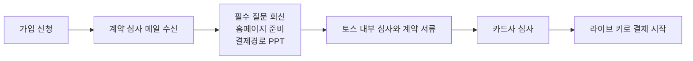

# 카드 심사에 필요한 개발

카드사는 **실제로 판매 중인 사이트**를 보고 심사합니다. 결제창만 붙여서는 통과할 수 없고, 상품·가격·사업자 정보·환불 정책·결제 경로가 공개된 운영 사이트에서 모두 확인되어야 합니다.

## 심사 절차

- 계약 심사 메일에 **1개월 안에 회신하지 않으면 신청이 취소**됩니다. 회신 방법은 [계약 심사 메일 회신](07-contract-review-reply.md)에 있습니다.
- 카드사 심사는 계약 완료 후 최대 10~14 영업일이 걸립니다. 일정은 이 기간을 넣어 잡으세요.

## 결제 구성

토스 담당자 안내 기준으로 브랜드페이는 심사가 1개월 이상 걸려, 이 템플릿은 다음 두 유형으로 구성합니다.

| 유형 | 무엇을 청구하나 | 카드 등록 방식 | 입력 항목 |
| --- | --- | --- | --- |
| 정기결제 | 1개월 구독료 | 토스 결제창 | 카드번호, 유효기간, 생년월일 |
| 자동결제 | 기본 1개월 구독에 더한 추가 사용료 | 자체 입력창에서 API 호출 | 카드번호, 유효기간, 생년월일, 비밀번호 앞 2자리 |

자체 입력창은 별도 계약 조건이 있을 수 있습니다. 개발 전에 [토스에 확인](04-toss-integration.md#개발-전에-토스에-확인할-것)하세요.

토스는 정기 구독형 서비스가 아니면 정책적으로 자동결제 사용을 제한합니다.

## 필요한 개발

| 카드사가 확인하는 것 | 개발할 내용 | 담당 | 화면 |
| --- | --- | --- | --- |
| 지금 구매할 수 있는 상품이 1개 이상 | 공개 랜딩에 실제 판매 상품의 이름, 설명, 가격 노출. 테스트 상품 불가 | 프론트 | `LandingPage` |
| 상품 이미지 | 실제 서비스 화면 이미지 사용. 빈 이미지나 같은 이미지 반복 금지 | 프론트 | `LandingPage` |
| 표시 금액 = 실제 결제 금액 | 부가세 포함 금액을 가장 크게 표시. 서버 청구액과 같은 값 사용 | 프론트·백엔드 | `LandingPage`, `SubscribePage` |
| 환불 정책 | 공개 페이지에 정책 전문 게시, 결제 직전 화면에 요약 게시 | 프론트 | `RefundPage`, `SubscribePage` |
| 배송 안내 | 무형 서비스는 제공 방법과 시점 안내로 대신 | 프론트 | `LandingPage` |
| 사업자 정보 | 푸터에 상호명, 대표자, 사업자등록번호, 주소(층수·동호수까지), 유선번호, 이메일, 통신판매업 신고번호 | 프론트 | 전 화면 |
| 사업자등록증 일치 | 상호명, 주소, 대표자를 등록증과 글자까지 같게 표기 | 운영 | `config.ts` |
| 결제 경로 접근 | 운영 서버의 운영 계정(아이디·비밀번호) 제공. test 같은 테스트용 아이디, 소셜 로그인 계정 불가 | 백엔드·운영 | `LoginPage` |
| 결제경로 파일 | 결제까지의 화면을 예시 파일과 같은 구성의 PPT로 제작 | 기획·운영 | [08](08-payment-path-file.md) |
| 서비스 제공기간 표시 | 결제 1회당 제공기간을 상품 페이지에 명확히 기재 | 프론트 | `LandingPage`, `SubscribePage` |
| 단건 결제 최고가 | 회신한 최고가를 넘는 청구가 없도록 추가 사용료 상한 적용 | 백엔드 | 정기 갱신 |
| 결제 연동 완료 | 운영 도메인에서 결제창까지 실제 동작 | 프론트·백엔드 | `ConsentStep` |
| 자동결제 동의 | 금액, 주기, 해지 등 조건 고지와 동의 저장 | 프론트·백엔드 | `ConsentStep` |
| 해지 방법 | 구독 관리에서 직접 해지 | 프론트·백엔드 | `BillingPage` |

## 상품 게시 규칙

- 테스트 상품, 0원 상품, 품절 상품은 심사할 수 없습니다.
- 바로 판매할 수 있는 상품이 1개 이상 있어야 하고, **카테고리마다** 1개 이상 있어야 합니다.
- 상품 금액과 결제 금액이 같아야 합니다.
- 이미지가 없거나 같은 이미지가 반복되면 안 됩니다. 이미지를 올린 뒤 잘 보이는지 확인하고, 이미지가 없는 상품은 설명을 자세히 적습니다.
- **가격 없이 문의나 상담 창구만 있으면 입점할 수 없습니다.** 엔터프라이즈 요금제처럼 가격 없이 "문의하기"만 둔 상품은 가격이 있는 상품과 함께 두고, 단독 카테고리로 만들지 마세요.

## 판매 정책 표기

구독 서비스는 무형재화이므로 **서비스 제공기간**과 **환불 정책**을 적습니다. 유형재화라면 배송기간과 교환·반품 안내를 적습니다.

- 서비스 제공기간은 결제 시점부터 서비스가 끝나는 시점까지의 최대 기간입니다. 미리 결제하고 기다리는 예약 기간이 있다면 그 기간도 포함합니다.
- 상품 설명에서 기간이 명확히 보여야 합니다. 설명에 넣기 어려우면 상품 아래에 따로 적습니다. 템플릿은 랜딩 요금제 카드의 가격 아래에 적습니다.
- 각 정책은 상품 구매 페이지나 이용약관에 적습니다.
- 환불 정책의 요건은 [정책 문서](06-policy-documents.md#환불-정책-요건)를 보세요.

## 반려되기 쉬운 경우

| 상황 | 대응 |
| --- | --- |
| 푸터에 다른 상호명이 적혀 있음 | 저작권 표기까지 사업자등록증 상호로 통일 |
| 연습용으로 적어 둔 가격이 실제 결제 금액과 다름 | 화면과 서버 금액을 같은 값에서 가져옴 |
| 부가세 별도 금액만 표시하고 결제는 부가세 포함으로 진행 | 부가세 포함 금액을 대표 금액으로 표시 |
| 테스트 환경에만 연동됨 | 운영 도메인에서 결제창이 열려야 함 |
| 통신판매업 신고번호가 없음 | 국민카드 심사가 제외됨. 간이과세자, 비영리기관, 공공기관은 없어도 됨 |
| 로그인해야 사업자 정보가 보임 | 공개 페이지와 로그인 화면에도 푸터 표시 |
| 정책이 준비 중이거나 "확정 전" 문구가 있음 | 확정본만 게시 |
| 약관·환불·개인정보 링크가 모두 같은 문서로 연결됨 | 문서를 분리해 각각 연결 |
| 테스트 상품이나 임시 가격을 올림 | 실제 판매 상품과 판매가로 게시 |
| 소셜 로그인 계정을 테스트 계정으로 전달 | 아이디·비밀번호 로그인 계정을 따로 준비 |
| dev, test, staging 같은 개발 주소나 test 같은 테스트 계정을 전달 | 운영 도메인과 운영 서버의 운영 계정만 전달 ([규칙](07-contract-review-reply.md#운영-url과-운영-계정만-쓴다)) |
| 3개월이 지난 서류나 열람용 서류 제출 | 발급일로부터 3개월 이내 제출용으로 재발급 |
| 푸터에 유선번호가 없거나 주소에 층수·호수가 빠짐 | 사업자등록증 기준으로 모두 기재 |
| 계약 심사 메일에 1개월 넘게 회신하지 않음 | 신청 취소. 재신청 필요 |
| 가격 없이 문의·상담 창구만 있음 | 판매가가 있는 상품 게시 |
| 심사 중에 상품이 품절되거나 결제창이 열리지 않음 | 심사가 끝날 때까지 판매 상태와 결제창 유지 |

## 금액·기간·업종 제한

토스가 안내하는 기준입니다. 상품이 해당하면 담당자와 먼저 협의하세요.

| 구분 | 기준 |
| --- | --- |
| 서비스 제공기간 | 결제 1회당 12개월 초과는 입점 불가. 6개월 초과는 가상계좌 사용 불가 |
| 배송 기간 | 6주 초과는 입점 불가 |
| 고가 상품 | 500만 원 이상은 반려되거나 별도 심사 협의가 필요할 수 있음 |
| 충전 서비스 | 1일 최대 결제 금액 5만 원 미만 |
| 상품권 | 1개월 최대 결제 금액 100만 원 미만 |
| 게임 | 1일 최대 결제 금액 5만 원 미만 |
| 유의 업종 | 일부 업종은 입점이 제한되거나 추가 서류 필요 |

사용량을 미리 사 두는 충전형 상품은 충전 서비스 기준에 걸릴 수 있습니다. 이 템플릿은 쓴 만큼 다음 결제일에 합산하는 후불 구조입니다. 상품·서비스에 따라 정산주기가 달라지거나 보증보험 가입을 요청받을 수 있습니다.

## 카드사 심사 기간 중 유의할 점

카드사 심사는 약 10~14일 걸립니다. 그동안 홈페이지를 그대로 유지하세요. 아래 항목을 바꾸면 카드사가 반려하고, **심사를 처음부터 다시 받아야 해서 정산이 늦어집니다.**

| 수정하면 안 되는 항목 | 템플릿 위치 |
| --- | --- |
| 하단 사업자정보와 전화번호 | `config.ts`의 `company`, `SiteFooter` |
| 상품 카테고리 | `config.ts`의 `plan`, `LandingPage` |
| 비회원 결제수단 | 이 템플릿은 회원 결제만 지원 |
| 판매 상태 (품절 등) | 요금제 노출 |

- 심사 중에 상품이 품절되거나 신용카드 결제창이 열리지 않아도 반려됩니다.
- 심사관은 비회원으로 들어가거나 회신한 운영 계정으로 로그인해 확인합니다. 그 계정의 비밀번호를 바꾸거나 계정을 잠그지 마세요.
- 이 기간에는 배포를 멈추거나, 위 항목을 건드리지 않는 변경만 배포하세요.

## 심사 전달 전 최종 점검

로그아웃한 시크릿 창에서 운영 도메인을 열어 확인합니다.

**공개 페이지**
- [ ] 상품 이름, 설명, 이미지, 부가세 포함 가격이 보인다
- [ ] 푸터의 상호명, 대표자, 주소가 사업자등록증과 같다. 주소에 층수·동호수까지 있다
- [ ] 푸터에 사업자등록번호, 유선번호, 이메일, 통신판매업 신고번호가 있다
- [ ] 상품 페이지에 서비스 제공기간이 보인다
- [ ] 테스트 상품, 0원 상품, 품절 상품, 가격 없는 문의 전용 상품이 없다
- [ ] 이용약관, 취소·환불 규정, 개인정보처리방침이 로그인 없이 각각 열린다
- [ ] 노란색 표시, 샘플 문구, 깨진 링크가 없다

**결제 경로**
- [ ] 운영 도메인에서, 운영 서버에 만든 운영 계정(아이디·비밀번호)으로 로그인된다
- [ ] 로그인 후 화면에 실제 데이터가 보인다
- [ ] 구독 시작부터 토스 결제창까지 막힘 없이 이동한다
- [ ] 결제 화면 금액이 랜딩 금액과 같다
- [ ] 자동결제 동의 체크박스가 기본으로 해제되어 있다

**구독 관리**
- [ ] 다음 결제일과 예정 금액이 보인다
- [ ] 카드를 추가·변경·삭제할 수 있다
- [ ] 로그인한 회원이 직접 해지할 수 있다
- [ ] 결제 내역을 볼 수 있다

**회신**
- [ ] 회신 메일과 결제경로 PPT의 URL이 모두 운영 도메인이다 (dev, test, staging 주소 없음)
- [ ] 제출 서류가 모두 발급일로부터 3개월 이내다
- [ ] [계약 심사 메일 회신](07-contract-review-reply.md)의 양식을 모두 채웠다
- [ ] [결제경로 PPT](08-payment-path-file.md)를 첨부했다

**정리**
- [ ] 운영 빌드(`npm run build`)로 배포, 미리보기 계정 삭제, `/toss-example` 경로 삭제
- [ ] 약관, 화면 문구, 서버 동작이 서로 같다 ([대조표](06-policy-documents.md#약관화면서버-대조표))

## 출처

- 토스페이먼츠 계약 심사 안내 메일 (2026-11 수신본 기준)
- [토스페이먼츠 계약과정 FAQ](https://tosspublic.notion.site/FAQ-78932357c9c34620bb8e1f311b2b14cc) 2, 3, 9, 10번
- [카드사 심사 통과 체크리스트](https://www.tosspayments.com/blog/articles/53711) (토스페이먼츠, 2026-10-06)
- [자동결제(빌링) 이해하기](https://docs.tosspayments.com/guides/v2/billing)
- 결제 구성은 토스 담당자 안내를 따랐습니다. 상점마다 다를 수 있습니다.
