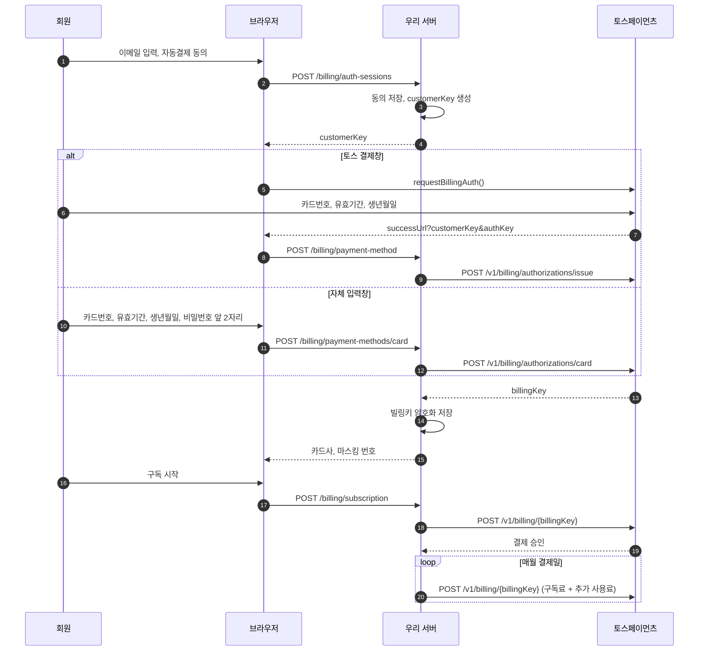

# 토스페이먼츠 연동

카드를 등록해 빌링키를 받고, 그 빌링키로 서버가 매월 결제합니다. **토스는 스케줄링을 제공하지 않으므로 결제 주기는 직접 구현합니다.**

## 개발 전에 토스에 확인할 것

자체 입력창(카드 정보로 빌링키 발급)은 공식 문서에 다음 내용이 있습니다.

- API로 연동하면 본인인증을 직접 구현해야 합니다. 결제창 방식은 토스가 휴대폰 본인인증을 제공합니다.
- 별도 계약이 필요합니다. 토스의 개발자용 요약 문서는 비인증 결제 자격과 PCI-DSS를 언급합니다.

담당자 안내와 문서가 어긋날 수 있으니 개발 전에 다음을 확인하세요.

1. 우리 상점 키로 `POST /v1/billing/authorizations/card` 를 쓸 수 있는가?
2. PCI-DSS 인증이나 비인증 결제 자격이 필요한가?
3. 본인인증을 어떤 수준으로 구현해야 하는가?
4. 카드 비밀번호 앞 2자리와 생년월일이 우리 계약에서 필수인가?

자체 입력창 계약이 어려우면 **토스 결제창만으로 카드를 등록**하세요. 구독료와 추가 사용료 청구는 어느 경로로 등록한 카드든 같습니다.

### 결제위젯을 쓰라는 안내를 받았다면

계약과정 FAQ는 직접 연동하는 상점에 결제위젯을 권합니다. 이 안내는 일반 결제 기준입니다. **결제위젯에는 빌링키 발급 기능이 없으므로** 자동결제는 API 개별 연동 키로 결제창(`requestBillingAuth`)을 엽니다. 정기결제용 결제경로 가이드도 정기결제용 카드 입력창을 캡처하라고 안내합니다. 일반 결제 상품을 함께 판다면 그 상품만 결제위젯으로 연동하고, 어느 방식으로 심사받을지 계약 담당자에게 확인하세요.

## 키

| 키 | 접두사 | 위치 | 용도 |
| --- | --- | --- | --- |
| 클라이언트 키 | `test_ck_`, `live_ck_` | 브라우저 | 결제창 열기 |
| 시크릿 키 | `test_sk_`, `live_sk_` | 서버 환경변수만 | 빌링키 발급, 결제, 조회, 삭제, 취소 |

- 같은 세트의 **API 개별 연동 키**를 씁니다. 결제위젯 키(`gck`)로는 빌링키를 발급할 수 없습니다.
- 자동결제 계약이 없는 키로 호출하면 `NOT_SUPPORTED_METHOD` 가 납니다.
- 시크릿 키는 코드, 브라우저, 주소, 로그, 메신저 어디에도 남기지 마세요.

```env
TOSS_CLIENT_KEY=test_ck_...
TOSS_SECRET_KEY=test_sk_...
```

## 전체 흐름

두 경로 모두 **동의를 먼저 서버에 저장**합니다. 동의를 브라우저를 거쳐 돌려받으면 위변조를 막을 수 없기 때문입니다.



## 1. customerKey 만들기

구매자를 구분하는 값이며 서버가 만듭니다.

- 22~50자. 영문 대소문자, 숫자, `-`, `_`, `=`, `.`, `@` 사용
- 이메일, 전화번호, 자동 증가 번호처럼 유추 가능한 값 금지
- 카드를 등록할 때마다 새로 만들고 한 장에만 사용

```js
const customerKey = `cus_${crypto.randomUUID().replaceAll('-', '')}`;
```

## 2. 토스 결제창으로 등록

브라우저 코드입니다. 템플릿의 [billing-auth.ts](../web/src/toss/billing-auth.ts)에 있고, `npm run dev` 후 `/toss-example` 화면에서 테스트 키로 실제 결제창을 열어 볼 수 있습니다.

```ts
import { loadTossPayments } from '@tosspayments/tosspayments-sdk';

const tossPayments = await loadTossPayments(clientKey);
await tossPayments.payment({ customerKey }).requestBillingAuth({
  method: 'CARD',
  successUrl: 'https://내도메인/payment-method/callback',
  failUrl: 'https://내도메인/payment-method/callback',
  customerEmail,
  customerName,
});
```

npm 대신 `<script src="https://js.tosspayments.com/v2/standard"></script>` 를 넣고 전역 `TossPayments(clientKey)` 로 초기화해도 됩니다.

- 성공하면 `successUrl` 로 `customerKey` 와 `authKey` 가 쿼리로 돌아옵니다.
- 실패하면 `failUrl` 로 `code` 와 `message` 가 돌아옵니다.
- `authKey` 는 일회성입니다. 받자마자 서버로 보내고 주소창에서 지웁니다.

서버 코드입니다. 예시는 Node.js이며 다른 언어도 같은 HTTP 호출입니다.

```js
const TOSS_API = 'https://api.tosspayments.com';

function tossHeaders(idempotencyKey) {
  // 시크릿 키 뒤의 콜론을 빠뜨리면 인증에 실패합니다.
  const credentials = Buffer.from(`${process.env.TOSS_SECRET_KEY}:`).toString('base64');
  return {
    Authorization: `Basic ${credentials}`,
    'Content-Type': 'application/json',
    ...(idempotencyKey === undefined ? {} : { 'Idempotency-Key': idempotencyKey }),
  };
}

async function issueBillingKey({ authKey, customerKey }) {
  const response = await fetch(`${TOSS_API}/v1/billing/authorizations/issue`, {
    method: 'POST',
    headers: tossHeaders(),
    body: JSON.stringify({ authKey, customerKey }),
  });
  return response; // 응답 처리는 "오류 처리"를 따릅니다.
}
```

호출 전에 `customerKey` 가 **이 회원이 동의를 저장할 때 받은 값인지** 확인하세요. 응답의 `customerKey` 도 요청과 같은지 확인합니다.

## 3. 자체 입력창으로 등록

앞의 [확인 사항](#개발-전에-토스에-확인할-것)이 끝난 경우에만 만듭니다.

```js
async function issueBillingKeyWithCard(card) {
  return fetch(`${TOSS_API}/v1/billing/authorizations/card`, {
    method: 'POST',
    headers: tossHeaders(),
    body: JSON.stringify({
      customerKey: card.customerKey,
      cardNumber: card.cardNumber, // 숫자 14~16자리
      cardExpirationYear: card.cardExpirationYear, // YY
      cardExpirationMonth: card.cardExpirationMonth, // MM
      customerIdentityNumber: card.customerIdentityNumber, // 생년월일 6자리 또는 사업자등록번호 10자리
      cardPassword: card.cardPassword, // 앞 2자리
    }),
  });
}
```

카드 정보가 우리 서버를 지나가므로 다음을 반드시 지킵니다.

| 항목 | 규칙 |
| --- | --- |
| 저장 | DB, 파일, 캐시 어디에도 저장하지 않음 |
| 로그 | 요청 본문 로깅, APM, 오류 추적 도구에서 이 경로를 제외. 로그에는 토스 거절 코드만 |
| 전송 | HTTPS만 허용 |
| 화면 | 입력값은 메모리에만 두고 요청 후 폐기. 실패하면 비밀번호만 지움 |
| 재사용 | `customerKey` 하나로 카드 한 장만 등록. 두 번째 요청은 409 |
| 안내 문구 | 오류 문구에 입력값을 넣지 않음 |

## 4. 빌링키 저장

- 발급 응답을 받는 즉시 **암호화해 저장**합니다. **빌링키는 다시 조회할 수 없습니다.**
- 화면에는 카드사와 마스킹 번호만 보냅니다. 빌링키는 서버 밖으로 나가지 않습니다.
- 첫 카드를 주 결제 카드로 지정합니다.
- 삭제는 토스의 `DELETE /v1/billing/{billingKey}` 를 먼저 호출한 뒤 DB를 갱신합니다.

## 5. 결제 승인

첫 결제와 정기 결제 모두 같은 API입니다. **금액은 서버가 계산하고 브라우저가 보낸 금액은 믿지 않습니다.**

```js
async function chargeBilling({ billingKey, customerKey, orderId, orderName, amount }) {
  return fetch(`${TOSS_API}/v1/billing/${encodeURIComponent(billingKey)}`, {
    method: 'POST',
    headers: tossHeaders(orderId), // 주문마다 고정된 멱등키로 중복 결제를 막습니다.
    body: JSON.stringify({ customerKey, orderId, orderName, amount }),
    signal: AbortSignal.timeout(60_000), // 승인은 최대 60초가 걸립니다.
  });
}
```

- `orderId`: 6~64자. 영문, 숫자, `-`, `_`, `=`
- `orderName`: 최대 100자. 추가 사용료가 있으면 이름에 밝힙니다.
- `Idempotency-Key`: 15일간 유효합니다. 오류 뒤에 키를 바꿔 다시 보내면 중복 결제될 수 있습니다.

처리 순서가 중요합니다.

1. DB 트랜잭션에서 주문을 `READY` 로 만듭니다.
2. 트랜잭션 **밖에서** 토스를 호출합니다.
3. 승인되면 주문을 `CONFIRMED` 로 먼저 기록합니다.
4. 구독 기간 연장 같은 내부 반영을 마칩니다.

영수증은 승인 응답의 `receipt.url` 을 저장해 결제 내역에서 보여줍니다.

## 6. 정기 갱신

서버 스케줄러가 짧은 주기(예: 1분)로 결제일이 지난 구독을 찾아 청구합니다.

| 항목 | 규칙 |
| --- | --- |
| 금액 | 구독료 + 끝난 주기의 추가 사용료 |
| 청구 상한 | 계약 심사에 회신한 단건 결제 최고가를 넘지 않게 추가 사용료에 상한을 둠 ([계약 심사 회신](07-contract-review-reply.md#④-단건-결제-최고가)) |
| 추가 사용료 | 제공량을 넘긴 양만 계산. 분 단위면 `floor(분 × 시간당 단가 ÷ 60)` |
| 다음 결제일 | 최초 결제일 기준. 그 날짜가 없는 달은 말일 |
| 동시 실행 | 구독 행을 잠그고 미결 주문을 확인해 한 번만 청구 |
| 실패 | 결제일을 옮기지 않고 D1, D3, D7에 재시도. D7까지 실패하면 `SUSPENDED` |
| 수동 결제 | 회원이 구독 관리에서 언제든 지금 결제 가능 |

직전 결제일에 한 달을 더하면 2월을 지나며 결제일이 앞당겨집니다. 최초 결제일로 돌아가게 계산하세요.

```js
/** 1월 31일에 시작한 구독은 2월 28일 다음에 3월 31일로 돌아옵니다. */
function nextBillingDate(dueAt, anchorDay) {
  const targetMonth = dueAt.getUTCMonth() + 1;
  const lastDay = new Date(Date.UTC(dueAt.getUTCFullYear(), targetMonth + 1, 0)).getUTCDate();
  const next = new Date(dueAt);
  next.setUTCFullYear(dueAt.getUTCFullYear(), targetMonth, Math.min(anchorDay, lastDay));
  return next;
}
```

## 오류 처리

토스 호출 결과는 네 가지로 나눕니다. **결과를 모르는 경우를 실패로 처리하면 이미 받은 돈 위에 한 번 더 청구할 수 있습니다.**

| 결과 | 판단 | 처리 |
| --- | --- | --- |
| 200 | 성공 | 주문 확정 |
| 4xx, 카드 코드 | 카드 문제 | 주문 `FAILED`. 회원에게 재입력 또는 카드 변경 안내 |
| 4xx, 키·권한 코드 | 우리 설정 문제 | 카드 오류로 보여주지 않음. 502로 응답하고 운영 알림 |
| 5xx, 타임아웃, 통신 오류 | **결과 불명** | 주문을 `READY` 로 두고 다시 청구하지 않음. 5분 뒤 조회로 확정 |

- 카드 코드 예: `INVALID_CARD_NUMBER`, `INVALID_CARD_EXPIRATION`, `INVALID_CARD_PASSWORD`, `INVALID_CARD_IDENTITY`, `INVALID_STOPPED_CARD`, `REJECT_CARD_COMPANY`, `EXCEED_MAX_AUTH_COUNT`
- 키·권한 코드 예: `UNAUTHORIZED_KEY`, `FORBIDDEN_REQUEST`, `NOT_SUPPORTED_METHOD`
- 결과 확인: `GET /v1/payments/orders/{orderId}`. 404면 청구가 도달하지 않은 것이므로 주문을 풀 수 있습니다.
- 전체 코드는 [에러 코드 문서](https://docs.tosspayments.com/reference/error-codes)를 보세요.

## 면세 상품

계약하면 과세 유형이 **복합과세**로 기본 설정됩니다. 결제를 요청할 때 면세 금액을 따로 보내지 않으면 전체를 과세로 승인합니다. 면세 서비스라면 결제 승인 요청 본문에 `taxFreeAmount` 를 넣으세요. 자세한 설정은 [과세 처리 문서](https://docs.tosspayments.com/common/tax)나 기술지원팀에 확인합니다. 이 템플릿의 금액은 모두 부가세 포함 과세 기준입니다.

## 환불

환불 규정을 게시했다면 실제로 환불할 수단이 있어야 합니다. 관리자 기능이나 운영 절차를 심사 전에 준비하세요.

```js
async function cancelPayment({ paymentKey, cancelReason, cancelAmount, idempotencyKey }) {
  return fetch(`${TOSS_API}/v1/payments/${encodeURIComponent(paymentKey)}/cancel`, {
    method: 'POST',
    headers: tossHeaders(idempotencyKey),
    // cancelAmount를 비우면 전액 취소, 금액을 넣으면 부분 취소입니다.
    body: JSON.stringify({ cancelReason, cancelAmount }),
  });
}
```

`paymentKey` 는 승인 응답에서 받아 주문에 저장해 둡니다.

## 저장 구조

```text
billing_consents   customer_key(PK), member_id, terms_version, autopay_agreed,
                   notification_email, agreed_at
payment_methods    id, member_id, customer_key(UNIQUE), encrypted_billing_key,
                   card_company, masked_number, is_default, is_active
subscriptions      member_id, status, anchor_day, next_billing_at, cancel_at, dunning_stage
payment_orders     order_id(PK), member_id, type, amount, status, payment_key,
                   receipt_url, approved_at
```

`terms_version` 과 `agreed_at` 은 분쟁 시 동의 증빙이므로 지우지 않습니다.

## 테스트

| 항목 | 방법 |
| --- | --- |
| 카드 등록 | 테스트 환경은 카드 번호 앞 6자리(BIN)만 유효해도 등록됩니다 |
| 본인인증 | 문자가 발송되지 않습니다. 인증 창에 `000000` 입력 |
| 결제 | 테스트 키는 실제로 청구되지 않습니다 |
| 오류 재현 | 테스트 키는 요청 헤더로 특정 오류를 재현할 수 있습니다. 헤더 이름과 값은 [코어 API 문서](https://docs.tosspayments.com/reference)나 기술 지원에서 확인하세요 |

## 라이브 전환

- [ ] 카드사 심사와 계약 완료를 확인했다
- [ ] 클라이언트 키와 시크릿 키를 **같은 세트의** `live_` 키로 바꿨다. 라이브 키는 [개발자센터](https://developers.tosspayments.com/) → 오른쪽 위 **내 개발정보** → 연동할 MID 선택 → **라이브**에서 복사합니다
- [ ] 소액으로 실제 카드 등록, 결제, 취소를 확인했다
- [ ] 테스트 환경의 빌링키를 라이브에 쓰지 않고, 라이브 키로 카드를 다시 등록받는다
- [ ] 정기 갱신 실패 알림을 운영자가 받는다

## 출처 (2026-11-02 확인)

- [토스페이먼츠 계약과정 FAQ](https://tosspublic.notion.site/FAQ-78932357c9c34620bb8e1f311b2b14cc) 5, 12번
- [자동결제(빌링) 결제창 연동](https://docs.tosspayments.com/guides/v2/billing/integration)
- [자동결제(빌링) API 연동](https://docs.tosspayments.com/guides/v2/billing/integration-api)
- [코어 API](https://docs.tosspayments.com/reference)
- [LLM Quick Reference](https://docs.tosspayments.com/guides/v2/get-started/llms-quick-reference): 자체 입력창의 별도 계약 조건
- [API 인증](https://docs.tosspayments.com/reference/using-api/authorization)
