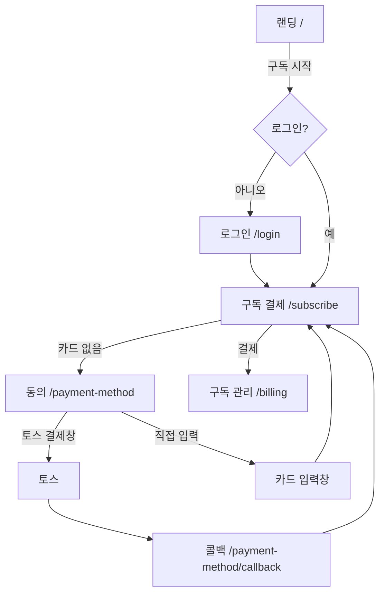
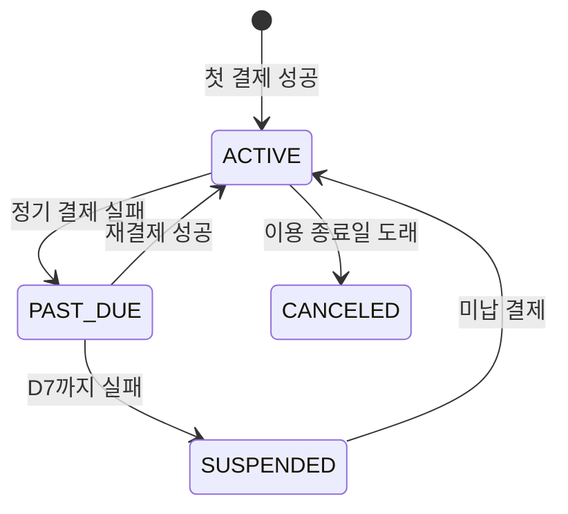

# 구독·자동결제 페이지

화면은 [web/](../web/)에서 `npm run dev` 로 바로 볼 수 있습니다. 화면은 [BillingApi](../web/src/api/types.ts)만 호출하므로, 서버가 아래 계약을 지키면 운영 빌드(`npm run build`)가 그대로 서버에 붙습니다. 서버 응답은 [schemas.ts](../web/src/api/schemas.ts)에서 Zod로 검증하고, 계약과 다르면 화면에 넘기지 않습니다.

## 화면 흐름



## 화면별 요구 사항

### 랜딩 `/` ([LandingPage](../web/src/pages/LandingPage.tsx))

로그인 없이 열리는 첫 화면입니다. 심사 담당자가 가장 먼저 봅니다.

- 상품 이름, 설명, 실제 서비스 이미지
- 부가세 포함 월 금액을 가장 크게 표시
- 제공량과 추가 사용 단가
- 자동 갱신과 해지 방법
- 서비스 제공 방법 (무형 서비스의 배송 안내)
- 취소·환불 요약과 전문 링크

### 구독 결제 `/subscribe` ([SubscribePage](../web/src/pages/SubscribePage.tsx))

결제 직전 화면입니다. 회원이 결제 전에 알아야 할 내용을 모두 한 화면에 둡니다.

| 항목 | 내용 |
| --- | --- |
| 주문 내용 | 상품, 제공량, 이용 기간, 결제 주기, 다음 결제 예정일, 추가 사용료 |
| 금액 | 공급가액, 부가세, 오늘 결제 금액 |
| 결제 수단 | 등록 카드의 카드사와 마스킹 번호. 없으면 카드 등록 버튼 |
| 환불 안내 | 요약과 규정 전문 링크 |
| 최종 동의 | 체크해야 버튼 활성화. 기본값은 해제 |
| 버튼 | 금액을 넣어 표시: `33,000원 결제하고 구독 시작` |
| 처리 중 | 버튼을 막아 중복 결제 방지 |

금액은 `GET /billing/checkout` 응답을 표시합니다. 화면에서 계산하지 않습니다.

### 결제 수단 등록 `/payment-method` ([ConsentStep](../web/src/pages/payment-method/ConsentStep.tsx), [CardForm](../web/src/pages/payment-method/CardForm.tsx))

1단계는 동의, 2단계는 카드 등록입니다.

| 항목 | 내용 |
| --- | --- |
| 결제 안내 이메일 | 형식이 맞아야 진행 |
| 자동결제 동의 | 일반 약관 동의와 **별도로** 받음. 기본값은 해제 |
| 고지 항목 | 금액, 주기와 결제일, 자동 갱신, 추가 사용료, 결제수단 변경, 해지, 결제 실패, 환불, 통지 수신처 |
| 등록 방식 | 토스 결제창, 카드 정보 직접 입력 |
| 카드 입력창 | 카드번호 4칸(자동 이동), `MM/YY`, 개인 생년월일 또는 법인 사업자등록번호, 비밀번호 앞 2자리 |
| 입력 실패 | 첫 오류 칸과 문구 표시. 서버가 거절하면 비밀번호만 지움 |

자체 입력창을 쓰지 않기로 했다면 `카드 정보 직접 입력` 버튼과 2단계를 지우세요.

### 등록 결과 `/payment-method/callback` ([PaymentMethodCallbackPage](../web/src/pages/payment-method/PaymentMethodCallbackPage.tsx))

- 성공은 `customerKey` + `authKey` 조합일 때만 인정합니다. 그 외에는 발급을 요청하지 않습니다.
- 결제사 원문 메시지와 오류 코드는 사용자에게 보여주지 않고 서버 로그에 남깁니다.
- `authKey` 가 방문 기록에 남지 않게 주소를 지웁니다.

### 구독 관리 `/billing` ([BillingPage](../web/src/pages/billing/BillingPage.tsx))

| 항목 | 내용 |
| --- | --- |
| 구독 상태 | 요금제, 시작일, 다음 결제일. 해지 예약 시 이용 종료일 |
| 다음 결제 예정 금액 | 구독료 + 추가 사용료 내역과 합계, 사용량 |
| 결제 수단 | 카드 목록, 주 결제 카드 지정, 추가, 삭제 |
| 결제 내역 | 일시, 유형, 상품, 금액, 상태, 영수증 |
| 미납 안내 | `PAST_DUE` 일 때 재시도 일정과 `지금 결제하기` |
| 해지 | 대화상자에서 이용 종료일을 안내하고 확정 |

## 구독 상태



`cancelAt` 은 상태와 별개인 해지 예약 값입니다. 예약만으로 상태가 바뀌지 않고, 이용 종료일까지 `ACTIVE` 를 유지합니다.

재시도 기간에 서비스를 유지할지 먼저 정하세요. 템플릿은 D7까지 유지하고 그 뒤 제한합니다. 약관, 화면 문구, 서버 동작이 모두 같아야 합니다.

## API 계약

경로는 [config.ts](../web/src/config.ts)의 `apiBaseUrl`(기본 `/api`) 뒤에 붙습니다. 요청과 응답은 JSON이고 필드는 camelCase입니다. 로그인은 쿠키 세션을 전제로 `credentials: 'include'` 로 요청합니다. 타입 정의는 [types.ts](../web/src/api/types.ts)가 기준입니다.

| 함수 | 요청 | 성공 응답 |
| --- | --- | --- |
| `login` | `POST /auth/login` `{ loginId, password }` | 사용자 |
| `logout` | `POST /auth/logout` | 204 |
| `getMe` | `GET /auth/me` | 사용자. 비로그인은 401 |
| `getCheckout` | `GET /billing/checkout` | 아래 Checkout |
| `getBilling` | `GET /billing` | 아래 Billing |
| `createAuthSession` | `POST /billing/auth-sessions` `{ termsVersion, autopayAgreed, notificationEmail }` | `{ customerKey }` |
| `issueBillingKey` | `POST /billing/payment-method` `{ customerKey, authKey }` | 결제 수단 |
| `registerCard` | `POST /billing/payment-methods/card` `{ customerKey, cardNumber, cardExpirationMonth, cardExpirationYear, customerIdentityNumber, cardPassword }` | 결제 수단 |
| `setDefaultPaymentMethod` | `PATCH /billing/payment-methods/{id}/default` | 204 |
| `deletePaymentMethod` | `DELETE /billing/payment-methods/{id}` | 204 |
| `startSubscription` | `POST /billing/subscription` | Subscription |
| `cancelSubscription` | `POST /billing/subscription/cancel` | Subscription |
| `payOverdue` | `POST /billing/subscription/renewal` | Subscription |

```ts
type User = { loginId: string; name: string; email: string | null };

type PaymentMethod = {
  id: string;
  cardCompany: string;
  maskedNumber: string;
  isDefault: boolean;
};

type Subscription = {
  status: 'ACTIVE' | 'PAST_DUE' | 'SUSPENDED' | 'CANCELED';
  planName: string;
  startedAt: string; // ISO 8601
  nextBillingAt: string;
  cancelAt: string | null; // 해지 예약 시 이용 종료일
};

type Checkout = {
  subscription: Subscription | null;
  paymentMethod: PaymentMethod | null; // 주 결제 카드
  quote: { supplyAmount: number; vatAmount: number; totalAmount: number };
  startsAt: string;
  nextBillingAt: string;
};

type Billing = {
  subscription: Subscription | null;
  paymentMethods: PaymentMethod[];
  payments: {
    id: string;
    paidAt: string;
    type: string;
    orderName: string;
    amount: number;
    status: string;
    receiptUrl: string | null;
  }[];
  usage: { usedUnits: number; includedUnits: number; unitLabel: string };
  nextCharge: { subscriptionAmount: number; overageAmount: number; totalAmount: number };
};
```

실패는 다음 형식으로 보냅니다. `code` 는 분기용 고정값이고 `message` 는 화면에 그대로 표시됩니다.

```json
{ "code": "CARD_REJECTED", "message": "카드 정보를 확인하고 다시 입력해 주세요." }
```

| 상황 | HTTP | code 예시 |
| --- | --- | --- |
| 비로그인 | 401 | `UNAUTHORIZED` |
| 동의 없음 | 400 | `CONSENT_REQUIRED` |
| 다른 회원의 customerKey | 404 | `CONSENT_NOT_FOUND` |
| 이미 사용한 customerKey | 409 | `CUSTOMER_KEY_USED` |
| 카드 거절 | 400 | `CARD_REJECTED` |
| 결제사 설정·통신 문제 | 502 | `PAYMENT_PROVIDER_UNAVAILABLE` |
| 등록 카드 없음 | 404 | `PAYMENT_METHOD_NOT_FOUND` |
| 이미 구독 중, 갱신 처리 중 | 409 | `SUBSCRIPTION_CONFLICT` |

## 피해야 할 화면 패턴

공정위가 규제하는 다크패턴에 해당할 수 있습니다.

- 자동결제 동의를 미리 체크해 두는 것
- 자동 갱신이나 결제 금액을 작은 글씨로 숨기는 것
- 첫 화면에 일부 금액만 보여주고 결제 직전에 다른 금액을 더하는 것
- 해지 버튼을 숨기거나 해지 경로를 가입 경로보다 어렵게 만드는 것
- 해지 화면에서 같은 만류 안내를 반복하는 것

## 출처

- [온라인 다크패턴 규제 안내](https://www.korea.kr/news/policyNewsView.do?newsId=148939436) (대한민국 정책브리핑)
